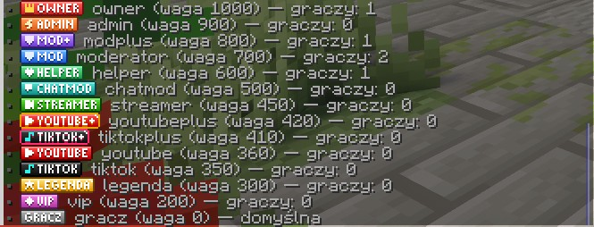
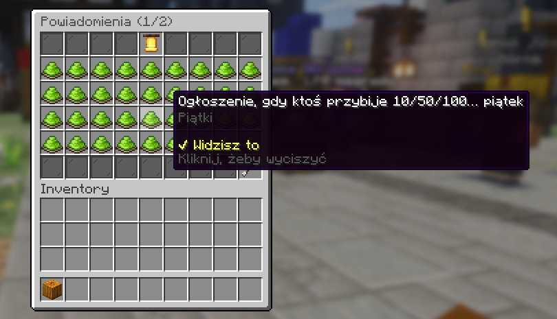

# SunCzat

**English** · [Polski](README.pl.md)

A chat plugin for Paper 26.2 with ranks, private messages, @mentions, showing off the item in your hand, anti-spam with a word filter, timed mutes and a custom TAB list.

<p align="center">
  
  
</p>

## Features

- **Ranks**: each one has a prefix, nick and message colors, a weight that sorts the TAB list, and permissions given together with the rank. The default config has 14 ranks, from Owner to Gracz (player). Players without a rank get the default one.
- **Rank badges**: a rank can show a small image instead of its text prefix. The plugin sends the resource pack on the loading screen and remembers who accepted it, so players without the pack still see text prefixes in chat.
- **Private messages**: `/msg` and `/r` with a sound. Admins can turn on a spy view of other players' private messages.
- **@mentions**: `@nick` is highlighted, and the mentioned player hears a sound and gets an action bar notice. Clicking a nick in chat starts a `/msg` to that player.
- **[item]**: type `[item]` (or `[i]`, `[przedmiot]`) to show the item in your main hand, with a hover preview
- **Anti-spam**: minimum gap between messages, a limit of messages per time window, no repeating the same message, and CAPS LOCK messages turned into lowercase
- **Word filter**: censors words that contain configured stems. Letter case, Polish diacritics and repeated letters don't get around it, some digit swaps (1→i, 3→e, 4→a, 0→o) are caught too, and there's a list of allowed exceptions.
- **Ignore**: `/ignoruj` hides a player's chat messages and private messages
- **Mutes** with a reason, for `30s`, `10m`, `2h`, `1d` or permanently
- **Notification settings**: `/powiadomienia` opens a menu where every player can turn off single notification types from all SunCraft plugins (through SunCore)
- **TAB list**: header and footer with an animated gold gradient, online count, ping and the player's rank
- Chat lines are sent by the server as system messages, so the filter and `[item]` look the same for everyone and clients don't mark messages as modified

## Requirements

- Paper **26.2**
- Java **25**
- [SunCore](https://github.com/oonnyyx/SunCore)

## Installation

1. Download `SunCzat.jar` and `SunCore.jar` from [Releases](../../releases/latest).
2. Drop both into `plugins/` and restart the server.
3. Give ranks with `/ranga daj <player> <rank>`.

## Commands

| Command | Description |
|---|---|
| `/msg <player> <message>` | Private message (aliases: `/w`, `/pw`, `/tell`, `/whisper`, `/napisz`) |
| `/r <message>` | Reply to the last private message |
| `/ignoruj [player]` | Ignore or stop ignoring a player; without a name, shows who you ignore |
| `/powiadomienia` | Choose which notifications you see |
| `/wycisz <player> [time] [reason]` | Mute a player; without a time the mute is permanent |
| `/odcisz <player>` | Unmute |
| `/ranga daj <player> <rank>` | Give a rank |
| `/ranga gracz <player>` | Check someone's rank |
| `/ranga lista` | All ranks with player counts |
| `/podglad` | Toggle spying on private messages |
| `/czat reload` | Reload the config |

| Permission | Description |
|---|---|
| `czat.admin` | Ranks, private message spy and reload (op by default) |
| `czat.wycisz` | Muting and unmuting (op by default) |
| `czat.bypass` | Skips anti-spam and the word filter (op by default) |

## Configuration

Everything is in `config.yml`: the chat line format (MiniMessage), ranks, anti-spam limits, filtered words and exceptions, mention and private message sounds, the resource pack and the TAB header and footer. Apply changes with `/czat reload`.

**Rank badges** use the `suncraft:rangi` font from the SunCraft resource pack (`SunCraft-pack.zip` in the [SunPrzedmioty release](https://github.com/oonnyyx/SunPrzedmioty/releases/latest)). Host the zip somewhere, put its URL and SHA-1 under `paczka`, and leave `resource-pack` in `server.properties` empty. If you don't use the pack, set `obrazek: ""` for every rank, so that text prefixes show up in TAB and above heads too.

In-game messages are in Polish.

## Building

```bash
git clone https://github.com/oonnyyx/SunCore && cd SunCore && mvn install && cd ..
git clone https://github.com/oonnyyx/SunCzat && cd SunCzat && mvn package
```

## License

[MIT](LICENSE)
